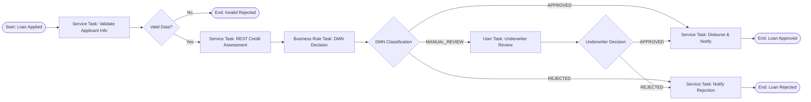

# LAB 1: End-to-End Loan Approval Automation Report

## 1. Problem Statement & Architecture
The objective of this lab is to develop an end-to-end loan approval workflow using **Camunda 8**. The automated solution combines:
- **BPMN 2.0 orchestration** executed on Zeebe engine.
- **DMN 1.3 decision tables** for risk classification and business rules.
- **External Java / Spring Boot job worker** for applicant information validation and business logic.
- **REST Connector / Mock Credit Assessment API** for real-time credit score retrieval.
- **Camunda Tasklist** for human underwriter manual review.
- **Camunda Operate** for process monitoring, variable inspection, incident detection, and failure recovery.



---

## 2. Process Variables Dictionary

| Variable Name | Data Type | Scope | Description / Purpose |
| :--- | :--- | :--- | :--- |
| `applicantId` | String | Global | Unique applicant identification (e.g., `APP-1001`) |
| `applicantName` | String | Global | Full name of loan applicant |
| `monthlyIncome` | Double | Global | Applicant's verified monthly income in USD |
| `requestedAmount`| Double | Global | Total loan principal requested |
| `isValidApplicant`| Boolean | Global | Flag produced by worker indicating applicant data integrity |
| `validationRemarks`| String | Global | Diagnostic comments from worker validation |
| `creditScore` | Integer | Global | Credit score returned from REST credit service (300-850) |
| `creditTier` | String | Global | Tier assessment (`EXCELLENT`, `FAIR`, `POOR`) |
| `loanDecisionResult`| Object | Global | DMN evaluation result object containing `loanDecision` and `decisionReason` |
| `loanDecision` | String | Global | `"APPROVED"`, `"REJECTED"`, or `"MANUAL_REVIEW"` |
| `underwriterDecision`| String | User Task | Underwriter's verdict (`"APPROVED"` / `"REJECTED"`) |
| `underwriterNotes`| String | User Task | Notes entered during Tasklist manual evaluation |

---

## 3. DMN Decision Table Specifications

**Decision ID:** `Decision_LoanApproval`  
**Hit Policy:** `FIRST` (Evaluates sequentially and triggers the first matching row)

| Rule # | Credit Score (`creditScore`) | Monthly Income (`monthlyIncome`) | Requested Amount (`requestedAmount`) | Output: `loanDecision` | Output: `decisionReason` |
| :---: | :---: | :---: | :---: | :---: | :--- |
| **1** | `>= 720` | `-` | `<= (monthlyIncome * 10)` | `"APPROVED"` | "Applicant has excellent credit score and safe income ratio" |
| **2** | `< 580` | `-` | `-` | `"REJECTED"` | "Credit score is below minimum acceptable threshold (580)" |
| **3** | `-` | `-` | `> (monthlyIncome * 20)` | `"REJECTED"` | "Loan amount exceeds maximum multiplier (> 20x monthly income)" |
| **4** | `[580..719]` | `-` | `<= (monthlyIncome * 12)` | `"MANUAL_REVIEW"` | "Moderate credit profile requires manual underwriter review" |
| **5** | `-` | `-` | `-` | `"MANUAL_REVIEW"` | "Application criteria require manual verification by credit committee" |

---

## 4. REST Connector & API Specification

### Endpoint
`POST http://localhost:8080/api/credit-assessment`

### Request Body (JSON)
```json
{
  "applicantId": "APP-1001",
  "applicantName": "Alice Johnson",
  "monthlyIncome": 6500.0,
  "requestedAmount": 30000.0
}
```

### Response Body (JSON)
```json
{
  "applicantId": "APP-1001",
  "creditScore": 750,
  "creditTier": "EXCELLENT",
  "status": "ASSESSED",
  "riskScore": 12.5
}
```

---

## 5. Test Matrix & Execution Results

| Case ID | Applicant | Income | Loan Amount | Credit Score | Expected Route | Observed Outcome | Status |
| :---: | :---: | :---: | :---: | :---: | :---: | :---: | :---: |
| **TC-01** | Alice Johnson | $6,500 | $30,000 | 750 | Direct Approval (DMN Rule 1) | Disbursed & Approved | **PASS** |
| **TC-02** | Bob Miller | $3,200 | $80,000 | 540 | Direct Rejection (DMN Rule 2) | Rejection Notice Sent | **PASS** |
| **TC-03** | Carol Danvers | $4,500 | $40,000 | 660 | Manual Review -> Tasklist -> Approved | Underwriter Approved & Disbursed | **PASS** |
| **TC-04** | Invalid User | -$500 | $10,000 | N/A | Worker Validation Gateway Failure | Rejected at Validation Gate | **PASS** |
| **TC-05** | Incident User | $5,000 | $20,000 | FAIL_TEST | REST Error / Worker Incident | Incident logged in Operate; Resolved & Retried | **PASS** |

---

## 6. Incident Investigation & Recovery in Operate

1. **Simulating the Failure**: Triggering an instance with `applicantId: "FAIL_TEST"` simulates an unexpected downstream REST failure or worker timeout.
2. **Detection in Camunda Operate**:
   - The instance flags a red incident badge on `Activity_CreditAssessment`.
   - Error trace displays: `CreditAssessmentException: Simulated Service Outage 500`.
3. **Resolution & Retry**:
   - Fix downstream endpoint or update the variable in Operate.
   - Click **"Retry Incident"** in the Operate console.
   - The Zeebe engine immediately resets the job retry counter, executes successfully, and advances to the DMN task without losing state.

---

## 7. Limitations & Recommendations
- **Security**: In production, the REST connector should authenticate using OAuth2/mTLS and credentials should be managed via Camunda 8 Secrets (`secrets.CREDIT_API_TOKEN`).
- **SLA Escalation**: Add non-interrupting boundary timer events on `Activity_UnderwriterReview` to remind underwriters if a task is unattended for more than 48 hours.
