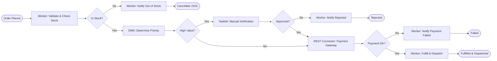

# LAB 2: End-to-End E-Commerce Order Processing and Fulfilment Report

## 1. Problem Statement & Architecture
The objective of this lab is to develop an automated order-processing and fulfilment workflow using **Camunda 8**. The solution orchestrates:
- **Inventory verification** and order total calculation via Spring Boot external job workers.
- **Priority determination** using a DMN decision table based on customer category, order value, and delivery preference.
- **Human exception verification** via Tasklist for high-value orders.
- **Payment processing** integration using a REST Connector to a simulated Payment Gateway.
- **Order fulfilment** and tracking dispatch.
- **Incident monitoring and recovery** in Camunda Operate.



---

## 2. Process Variables Dictionary

| Variable Name | Data Type | Scope | Description / Purpose |
| :--- | :--- | :--- | :--- |
| `orderId` | String | Global | Unique identifier of customer order (e.g., `ORD-501`) |
| `customerId` | String | Global | Identifier of purchasing customer (`CUST-9901`) |
| `customerCategory` | String | Global | Customer tier (`VIP`, `REGULAR`, `GUEST`) |
| `productId` | String | Global | SKU of requested merchandise |
| `quantity` | Integer | Global | Quantity requested |
| `unitPrice` | Double | Global | Price per unit |
| `orderTotal` | Double | Global | Computed total (`quantity * unitPrice`) |
| `stockStatus` | String | Global | Stock status (`"IN_STOCK"` or `"OUT_OF_STOCK"`) |
| `deliveryPreference` | String | Global | Shipping speed (`"EXPRESS"` or `"STANDARD"`) |
| `priorityDecision` | Object | Global | DMN result containing `orderPriority`, `slaHours`, and reason |
| `managerApproved` | Boolean | User Task | Supervisor's verification verdict |
| `paymentToken` | String | Global | Mock payment authorization token |
| `paymentStatus` | String | Global | REST gateway outcome (`"SUCCESS"`, `"DECLINED"`) |
| `transactionId` | String | Global | Gateway transaction reference |
| `trackingNumber` | String | Global | Fulfilment courier tracking number |

---

## 3. DMN Decision Table Specifications

**Decision ID:** `Decision_OrderPriority`  
**Hit Policy:** `FIRST`

| Rule # | Order Total (`orderTotal`) | Customer Category (`customerCategory`) | Delivery Preference (`deliveryPreference`) | Output: `orderPriority` | Output: `slaHours` | Output: `priorityReason` |
| :---: | :---: | :---: | :---: | :---: | :---: | :--- |
| **1** | `-` | `"VIP"` | `-` | `"HIGH"` | 4 | VIP customer tier gets 4-hour expedited handling |
| **2** | `>= 1000` | `-` | `-` | `"HIGH"` | 6 | High order value qualifies for expedited 6-hour dispatch |
| **3** | `-` | `-` | `"EXPRESS"` | `"HIGH"` | 8 | Customer paid for express shipping |
| **4** | `[200..999]` | `"REGULAR"` | `"STANDARD"` | `"MEDIUM"` | 24 | Standard regular order fulfillment within 24 hours |
| **5** | `-` | `-` | `-` | `"LOW"` | 48 | Standard 48-hour fulfillment queue |

---

## 4. REST Connector & API Specification

### Endpoint
`POST http://localhost:8080/api/payment/process`

### Request Body (JSON)
```json
{
  "orderId": "ORD-501",
  "customerId": "CUST-9901",
  "amount": 750.0,
  "paymentToken": "tok_visa_valid"
}
```

### Response Body (JSON)
```json
{
  "orderId": "ORD-501",
  "paymentStatus": "SUCCESS",
  "transactionId": "TXN-8849102",
  "timestamp": "2026-11-01T20:00:00Z",
  "message": "Payment authorized and captured successfully"
}
```

---

## 5. Test Matrix & Execution Results

| Case ID | Customer | Items / Price | Stock | Priority | Exception / Tasklist | Payment | Outcome | Status |
| :---: | :---: | :---: | :---: | :---: | :---: | :---: | :---: | :---: |
| **TC-01** | VIP User | 1 x $450 | IN_STOCK | HIGH (4h) | None | SUCCESS | Fulfilled & Dispatched | **PASS** |
| **TC-02** | Regular User | 100 x $20 | OUT_OF_STOCK | N/A | N/A | Skipped | Cancelled (Out of Stock) | **PASS** |
| **TC-03** | Guest User | 1 x $180 | IN_STOCK | LOW (48h) | None | DECLINED | Payment Failed Notification | **PASS** |
| **TC-04** | Regular User | 6 x $1,000 | IN_STOCK | HIGH (6h) | High Value Tasklist (Approved) | SUCCESS | Dispatched after Supervisor Approval | **PASS** |
| **TC-05** | Regular User | 1 x $350 | IN_STOCK | MEDIUM | None | Service Outage (Incident) | Incident in Operate -> Retried -> Fulfilled | **PASS** |

---

## 6. Incident Investigation & Recovery in Operate

1. **Simulated Failure**: Passing `paymentToken: "tok_gateway_error"` triggers an HTTP 504 error response from the payment endpoint.
2. **Operate Diagnostic**:
   - The Zeebe engine exhausts the 3 configured retries.
   - An incident is automatically raised on `Activity_ProcessPayment`.
   - Operate details error: `PaymentGatewayException: Payment Gateway Timeout 504 Gateway Unavailable`.
3. **Resolution**:
   - The payment gateway service is restarted or the token variable is corrected to a valid token directly in Operate.
   - The operator clicks **"Retry Incident"**.
   - Zeebe resumes execution from `Activity_ProcessPayment` and the order completes without data loss.

---

## 7. Assumptions & Limitations
- **Inventory Concurrency**: In this simulated educational lab, inventory levels are evaluated in-memory. In enterprise production, a distributed locking mechanism or two-phase reservation pattern (Saga pattern) should be used.
- **Idempotency**: The payment REST call uses `orderId` as an idempotency key to prevent accidental duplicate charges during worker retries.
