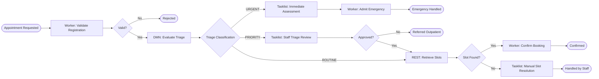

# LAB 3: End-to-End Hospital Appointment and Patient Triage Management Report

## 1. Problem Statement & Architecture
The objective of this lab is to engineer an automated, robust hospital appointment intake and triage workflow using **Camunda 8**. The solution orchestrates:
- **Patient registration validation** via a Spring Boot external worker.
- **Clinical triage classification** via DMN decision tables (`URGENT_ASSESSMENT`, `PRIORITY_REVIEW`, `ROUTINE`).
- **Immediate clinical assessment** via Tasklist for emergency admissions.
- **Staff nurse triage review** via Tasklist for priority escalations.
- **Dynamic slot retrieval** using a REST connector calling a simulated Hospital Scheduling API.
- **Manual slot resolution** via Tasklist when slots are unavailable.
- **Incident diagnosis and recovery** in Camunda Operate.



---

## 2. Process Variables Dictionary

| Variable Name | Data Type | Scope | Description / Purpose |
| :--- | :--- | :--- | :--- |
| `patientId` | String | Global | Synthetic patient reference code (e.g. `PAT-7701`) |
| `patientName` | String | Global | Full patient name |
| `age` | Integer | Global | Patient age in years |
| `symptomsSummary` | String | Global | Text description of presenting symptoms |
| `painLevel` | Integer | Global | Patient reported pain scale (1 - 10) |
| `hasPreexistingCondition` | Boolean | Global | Medical history flag |
| `preferredSpecialty` | String | Global | Target medical department (`CARDIOLOGY`, etc.) |
| `appointmentPreferenceDate`| String | Global | Preferred date (`YYYY-MM-DD`) |
| `isValidRegistration` | Boolean | Global | Worker verification status |
| `triageDecision` | Object | Global | DMN result object with category and protocol |
| `staffReviewApproved` | Boolean | User Task | Nurse triage review decision |
| `slotsAvailable` | Boolean | Global | Scheduling API slot availability flag |
| `slotId` | String | Global | ID of allocated appointment slot |
| `assignedDoctor` | String | Global | Clinician assigned to the appointment |

---

## 3. DMN Decision Table Specifications

**Decision ID:** `Decision_PatientTriage`  
**Hit Policy:** `FIRST`

| Rule # | Pain Level (`painLevel`) | Has Preexisting Condition (`hasPreexistingCondition`) | Urgency Indicator (`urgencyIndicator`) | Output: `triageCategory` | Output: `triageProtocol` | Output: `maxWaitHours` |
| :---: | :---: | :---: | :---: | :---: | :--- | :---: |
| **1** | `>= 8` | `-` | `-` | `"URGENT_ASSESSMENT"` | Immediate Emergency Physician Protocol | 0 |
| **2** | `-` | `-` | `"HIGH"` | `"URGENT_ASSESSMENT"` | Emergency Department Red Alert Protocol | 0 |
| **3** | `[5..7]` | `-` | `-` | `"PRIORITY_REVIEW"` | Rapid Assessment Nurse Triage Protocol | 2 |
| **4** | `-` | `true` | `-` | `"PRIORITY_REVIEW"` | Specialist Triage and Fast-Track Review | 4 |
| **5** | `-` | `-` | `-` | `"ROUTINE"` | Direct Outpatient Scheduling Protocol | 48 |

---

## 4. REST Connector & API Specification

### Endpoint
`GET http://localhost:8080/api/hospital/slots?specialty=CARDIOLOGY&date=2026-11-05`

### Response Body (JSON - Available)
```json
{
  "status": "AVAILABLE",
  "slotsAvailable": true,
  "specialty": "CARDIOLOGY",
  "appointmentDate": "2026-11-05",
  "slotId": "SLOT-C8-101",
  "slotTime": "10:30 AM",
  "assignedDoctor": "Dr. Gregory House",
  "roomNumber": "B-204"
}
```

---

## 5. Test Matrix & Execution Results

| Case ID | Patient | Symptoms / Pain | Triage Result | User Task Route | Slots Found | Outcome | Status |
| :---: | :---: | :---: | :---: | :---: | :---: | :---: | :---: |
| **TC-01** | Alice Smith | Mild backache / Pain: 2 | ROUTINE | None | Yes (Cardiology) | Appointment Confirmed (SLOT-C8-101) | **PASS** |
| **TC-02** | Bob Jones | Chest pressure / Pain: 6 | PRIORITY_REVIEW | Staff Triage Review (Approved) | Yes | Reviewed & Appointment Booked | **PASS** |
| **TC-03** | Charlie Brown | Acute severe trauma / Pain: 9 | URGENT_ASSESSMENT | Immediate Clinical Assessment | N/A | Admitted to Emergency Protocol | **PASS** |
| **TC-04** | Dave Wilson | Headache / Pain: 3 | ROUTINE | None | No (Neurology fully booked) | Staff Slot Resolution in Tasklist | **PASS** |
| **TC-05** | Incident Case | Specialty: FAIL_TEST | ROUTINE | None | 503 Scheduling Outage | Incident raised in Operate -> Retried -> Pass | **PASS** |

---

## 6. Incident Investigation & Recovery in Operate

1. **Failure Simulation**: Specifying `preferredSpecialty: "FAIL_TEST"` simulates a 503 Service Unavailable fault from the scheduling backend.
2. **Operate Diagnostic**:
   - The instance enters incident status with red indicator at `Activity_RetrieveAppointmentSlots`.
   - Incident message: `HospitalSchedulingException: Scheduling Service 503 Service Unavailable`.
3. **Recovery**:
   - The scheduling mock server is verified/restored, or the variable `preferredSpecialty` is updated in Operate to `"CARDIOLOGY"`.
   - The operator triggers **"Retry Incident"**.
   - The job succeeds immediately, slots are retrieved, and the appointment confirms cleanly.

---

## 7. Assumptions & Limitations
- **HIPAA / Data Privacy**: Only synthetic patient data is processed in accordance with privacy requirements.
- **Real-Time Integration**: In production healthcare workflows, HL7 / FHIR REST APIs are standard, and webhooks or Kafka topics are used for real-time schedule slot updates.
